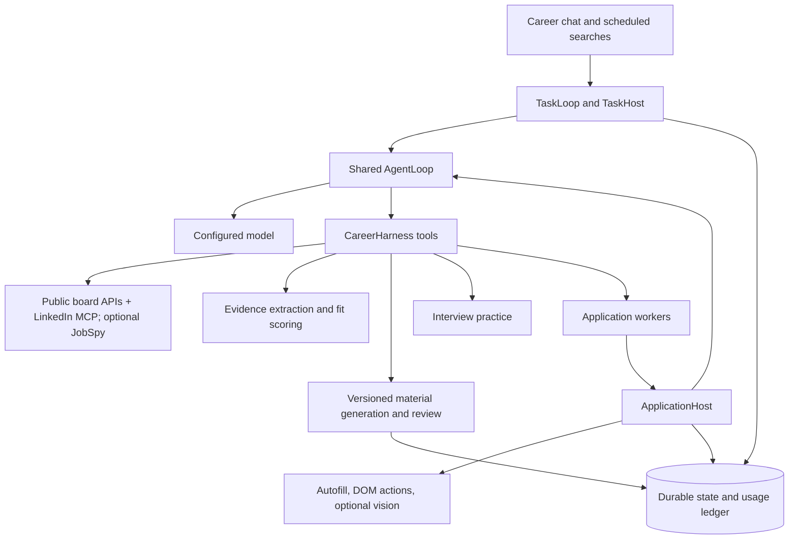

# Agent architecture

[Home](../README.md) · [Configuration](configuration.md) ·
[Development](development.md)

Eregion combines a shared decision loop with a career-specific harness. The model
chooses tools and work order. Domain services own candidate facts, document
verification, browser state, permissions, and final submission.

## Runtime map

| Component | Responsibility |
| --- | --- |
| [`core/engine.py`](../backend/eregion/runtime/core/engine.py) | Observe, decide, validate advertised actions, execute, checkpoint, and yield. |
| [`core/context.py`](../backend/eregion/runtime/core/context.py) | Retain complete model/tool exchanges within a bounded window. |
| [`core/model.py`](../backend/eregion/runtime/core/model.py) | Interruptible model waits, deadlines, and obsolete-request handling. |
| [`tasks/host.py`](../backend/eregion/runtime/tasks/host.py) | Current request, conversation controls, result waits, persistence, and explicit completion. |
| [`career/harness.py`](../backend/eregion/runtime/career/harness.py) | Job discovery, importing, scoring, materials, application handoff, and interviews. |
| [`request_context.py`](../backend/eregion/runtime/request_context.py) | Compact observations, full-source archives, read progress, and resource freshness. |
| [`auto_apply/runner.py`](../backend/eregion/runtime/auto_apply/runner.py) | Application observations, form actions, questions, validation, and review. |
| [`browser/manager.py`](../backend/eregion/runtime/browser/manager.py) | General browsing sessions and bounded browser recovery. |
| [`provider_usage.py`](../backend/eregion/runtime/provider_usage.py) | Actual provider-call accounting, task/run attribution, and usage summaries. |

The persisted session/tool APIs use the same kernel. `eregion.domain.workflow`
contains the deterministic `AnalysisWorkflow` for resume analysis; it is not an
autonomous planner and has no AgentLoop alias. The old top-level packages and
compatibility forwarding modules are removed. The active runtime does not use LangGraph.

## One turn, explicit outcomes

The host constructs a current observation and advertises available tools. The
loop invokes the model, validates requested actions, executes them through the
host, and persists the results. Work can continue across bounded worker slices.

Conversation controls distinguish progress, questions, waiting, pausing, and
completion. `finish_task` is the explicit completion decision, including for
ordinary questions and greetings. Plain assistant text is progress; a promise to
act cannot complete an unexecuted request. Application completion additionally
depends on the actual form and review state.

`wait_for_result` hands off a task while a child capability runs. It avoids polling
an unchanged material report or application archive through repeated model calls.
The parent resumes when the capability completes or needs input.

## Steering and recovery

Each new user message advances the chat revision. `current_request` is rebuilt
from durable messages, while the creation goal remains historical context. A
decision from an older revision cannot execute after new feedback arrives.

In-flight operations are journaled before execution. After interruption or a
restart, the host inspects current state rather than replaying uncertain external
effects. The same task retains its progress and budget; restarting the service
does not grant a new call allowance. Explicit new user turns have their own
recorded budget boundary while cumulative usage remains available.

Already-sent provider calls may still finish and be billed after interruption.
Their discarded results do not become current evidence. This mechanism is not
provider-side cancellation or universal exactly-once execution.

Application answer batches have stable identities. Retryable validation failures
retain the original answers and use bounded recovery. Interview state similarly
preserves submitted answers, evaluations, and completion progress.

## Context without losing source access

The model receives compact current observations and complete recent exchanges.
Large sources remain available in a task-local archive. Compaction preserves
valid tool-call/result groups rather than cutting JSON or replaying an entire
archive inside another archive.

`read_context` supports focused paths and pages with recorded read progress.
Explicit rereads remain subject to no-progress checks. Historical content is
available for deliberate inspection, but does not supersede current application
values, material versions, or the latest user request.

Resource freshness accounts for nested material item versions and status.
Reduced projections are not automatically newer resources; late older results
cannot replace current versions. Stale references lead to a current summary or a
new observation instead of serving as complete current evidence.

Application review projections carry observed values and document selections.
Detailed source and field metadata remain accessible when needed. This reduces
repeated full-form reads without replacing facts with a generated summary.

## Sources, scoring, and materials

Job descriptions come from observed/retrieved postings or explicitly supplied job
text. A task instruction containing a URL is not itself a job description and
must not overwrite a known posting.

Resume extraction preserves source ownership: employer or project, school,
degree, dates, status, and supporting text. Source completion reconstructs owned
sentences and entries across PDF line wraps. Normalization must not merge similar
facts across unrelated employers or collapse distinct education records.

Validated extraction and fit analysis can be reused through content- and
configuration-sensitive caches. Confirmed evidence, source changes, schema/prompt
identity, model configuration, and routing affect reuse. A cache hit does not
justify reusing stale candidate facts.

Material packs freeze their evidence and job snapshot. Writers produce versioned
artifacts; structural/source checks and semantic verification gate review.
Revision is bounded. Foundational sections such as education and skills are
restored from valid sources, not from unsupported generated text.

Selection records bind approval to the actual item/version and evidence context.
Older successful materials remain visible when a newer item fails or lacks an
artifact. An invalid explicit choice requires resolution; it cannot silently
fall back to a different approved item. The browser uses the selected content,
not merely a filename or a reference in the parent task.

See [Career evidence](../backend/eregion/runtime/evidence/README.md) for evidence lifecycle
and its distinction from memory.

## Browser execution

Application workers combine deterministic filling with model-selected DOM actions
and optional screenshot actions. The host can fill known fields mechanically;
the model handles unresolved choices, dependent controls, navigation, and missing
information. Field results are checked against the live page.

Action references belong to an observed page. A stale reference triggers a fresh
observation with `action_performed=false`; the previous action is not silently
replayed. Recoverable closed-browser failures use bounded recreation and return
the new state. A transport failure is not classified as an employer login block.

Browser contexts remain isolated between attempts. Closing one context must not
close an active sibling. When the last shared context closes, browser-pool
ownership is cleared so a later task does not reuse a closed target.

Education bindings associate controls with specific source records. Formatting
projects a known date into the page's requested representation without inventing
missing parts or changing an expected-graduation fact. Dependent menus are
explored before selecting their leaf; entering search text is not a selection.

Passwords use a dedicated account workflow. Screenshot access is separate from
the local preview. Consent, sensitive factual answers, and final submission retain
their own checks. An uncertain submission becomes an explicit unknown outcome,
not an automatic resubmission.

## Performance and extension points

Optional Jev decisions run inside eligible tools, not as a mandatory front-end
router. Matching calls are gated by expected batch reduction and request size.
The main model retains planning, writing, verification, and unresolved decisions.
See [Jev and performance](jev-benchmark.md).

To add a capability, extend the relevant host/tool interface, define provenance
and side-effect boundaries, and persist enough state for recovery. A new domain
can provide a host for the shared loop instead of embedding its workflow into
the kernel. Governed MCP tools and skill packages cannot expand the permissions
granted by their host.

Test current-request preservation, stale observations, interrupted effects,
explicit completion, and budget continuity alongside the new capability.
See [Development](development.md) for local and live validation.
