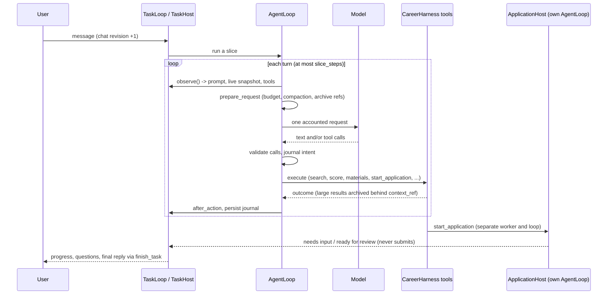

# How Eregion works inside

[Docs index](../README.md) · [Architecture overview](../agent-loop.md) ·
[Configuration](../configuration.md)

These pages explain how each part of the agent is built and how it handles data:
what the model sees, which prompts it gets, what is remembered, how calls are
budgeted, and which rules no model output can override. They describe the code
as it is; each section links to the module that implements it.

| Page | What it explains |
| --- | --- |
| [Decision loop](decision-loop.md) | The single `AgentLoop`: one turn step by step, hosts, batches, journaling, stops and recovery |
| [Context engineering](context-engineering.md) | How each model request is assembled, sized and compacted, and how archived data is read back |
| [Prompts](prompts.md) | Every prompt, where it lives, how it is composed at runtime, and the rules all prompts share |
| [Memory](memory.md) | The memory layers: loop journal, task state, governed memory, task memory, saved answers, evidence, learning, skills |
| [Models and budgets](models-and-budgets.md) | Model roles, routing, the provider ledger, call and token limits, retries and timeouts |
| [Tools and safety](tools-and-safety.md) | Tool definitions, validation, batch rules, repeat guards, error recovery, credentials and the submission fence |
| [Application agent](application-agent.md) | How a job application form is observed, filled, verified and stopped at review |
| [Career workflows](career-workflows.md) | Job search, posting qualification, fit scoring, recommendations, documents and interviews |

## One request, end to end

The same kernel runs every autonomous decision. A host decides what is observed,
which tools are offered and how results are persisted; the kernel only decides
the order of observe, ask the model, validate, execute and save.

## Design rules that run through every page

- **The model owns meaning; code owns boundaries.** The model interprets
  questions, chooses records and options, and writes text. Code validates
  arguments, checks sources, verifies writes on the page and blocks unsafe
  actions. Code never silently decides a semantic question for the model.
- **Untrusted text stays data.** Web pages, resumes, job descriptions, tool
  results and stored memory are labelled as data and can never change the goal,
  permissions or safety rules.
- **Nothing is lost by compaction.** Large values move into an archive behind a
  reference that the model can read back; the live controls and the current
  request are never truncated to meet a size.
- **Every provider call is accounted.** Calls, tokens, cached tokens and
  reservations go into one ledger with a purpose label; budgets are checked
  before sending.
- **Final submission is never a model action.** Applications stop at review; a
  human confirms the exact reviewed form.
