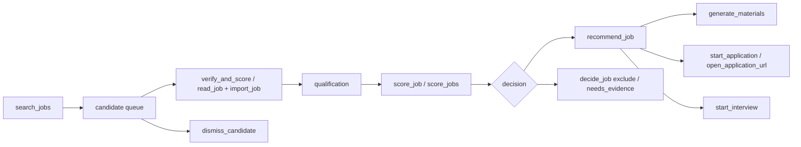

# Career workflows

[Internals](README.md) · [Prompts](prompts.md) · [Memory](memory.md) ·
[Application agent](application-agent.md)

The career agent is the `CareerHarness`
([`career/harness.py`](../../backend/eregion/runtime/career/harness.py)) running
on the shared loop through `TaskHost`. It has no fixed pipeline: the model
chooses which capabilities to use and in which order. This page describes what
each capability does and which rules it enforces regardless of the model.

## Finding jobs

- **Sources.** In API-first mode (`JOB_AGENT_JOB_API_FIRST`, on by default) the
  agent searches verified public company-board APIs and the configured LinkedIn
  MCP server with `search_jobs`. JobSpy is an optional extra source run out of
  process ([`jobspy_source.py`](../../backend/eregion/runtime/career/jobspy_source.py)).
  The research browser is for explicit page checks or missing details. A
  LinkedIn-only request uses only LinkedIn.
- **Board directory.** [`board_directory.py`](../../backend/eregion/runtime/career/board_directory.py)
  selects verified boards by role family and location; stale entries never
  enter automatic selection.
- **Read-only discovery.** [`discovery.py`](../../backend/eregion/runtime/career/discovery.py)
  sends no candidate data or cookies, compares locations by explicit city and
  state components, and only calls public ATS listing APIs (JSON), not arbitrary
  vendor pages.
- **LinkedIn.** [`linkedin_source.py`](../../backend/eregion/runtime/career/linkedin_source.py)
  wraps the MCP tools with a per-batch call budget (26 calls by default), a
  per-call deadline and stop conditions; a stopped source is not retried
  through another channel and there is no implicit login.
- **Candidate queue.** Observed posting cards go into a bounded queue
  ([`candidate_queue.py`](../../backend/eregion/runtime/career/candidate_queue.py));
  new discovery waits while started candidates are unfinished, and
  [`decisions.py`](../../backend/eregion/runtime/career/decisions.py) makes
  discovery wait until every scored job of the request has an outcome.
- **Coverage and health.** Each search records what it covered (provider totals
  against cards seen, boards searched and remaining, yield per source,
  distinct employers) and source failures for the current user turn
  ([`source_health.py`](../../backend/eregion/runtime/career/source_health.py)).
  The model uses these facts to decide whether to continue
  (`SEARCH_STOP_RULE`), and the final reply must report them.
- **User constraints.** Role, location, seniority and source restrictions come
  from the user's request ([`search_policy.py`](../../backend/eregion/runtime/career/search_policy.py));
  a model plan or a tool query is not authority for them.

## Qualifying and scoring a posting

- **Reading.** `read_job` reads and caches the canonical posting through
  LinkedIn MCP or public APIs, selecting the posting body before flattening
  HTML, so a whole web page is never scored
  ([`job_body.py`](../../backend/eregion/runtime/career/job_body.py)).
  `verify_and_score` reads, qualifies, imports and scores one posting in a
  single call; `verify_and_score_jobs` does the same for up to 20 URLs and only
  scores as many as the remaining budget can finish.
- **Qualification.** [`qualification.py`](../../backend/eregion/runtime/career/qualification.py)
  stores the model's judgment (prompt `POLICY` in
  [`domain/search_qualification.py`](../../backend/eregion/domain/search_qualification.py))
  of whether a posting is a current, identifiable vacancy matching the
  requested role, location and seniority. Code validates identity, citations
  and freshness (request and body hashes); posting conditions on the candidate
  are kept only when quoted verbatim from that posting. When two verified
  opinions exist for the same posting, each field keeps the more inclusive one.
- **Dismissing.** `dismiss_candidate` excludes a retrieved but unsuitable
  posting for this user turn without paid scoring; it must quote the posting's
  exact title, location or text and give the reason. Exclusions are durable for
  the turn and every research tool checks them before any I/O
  ([`candidate_health.py`](../../backend/eregion/runtime/career/candidate_health.py)).
- **Scoring.** `score_job` / `score_jobs` (up to 16 jobs in one batch) compare
  the resume with the posting through the workspace analysis service. With
  `TYPESAFE_ENABLED`, fit scoring uses Jev yes/no decisions per requirement
  and computes the score locally; otherwise the main-model analyzer is used.
  Results are cached by the exact resume, job text, supplied facts, owner,
  model release and implementation identity. See
  [Jev and performance](../jev-benchmark.md).

## Recommending

- `recommend_job` presents a read and scored job in one tier: **priority**,
  **stretch** (a core required gap) or **to_confirm** (a personal fact the
  resume and user do not state, or a near-miss on level or location), with
  exact quotes from the posting supporting the reason and each gap stated.
- `decide_job` records the other outcomes: excluded (not an opportunity) or
  needs evidence (the posting itself is too unclear).
- Decisions hold for one user request and one score.
- The final reply follows `FINAL_FORMAT` (see [Prompts](prompts.md)): tiers with
  counts, title, URL, the saved score, gaps and a next step per job, excluded
  jobs, failed reads, the honest shortfall and an offer to continue.
- **Scheduled searches.** `configure_job_alert` creates a daily recommendation
  schedule requested by the user (a time zone is required and never guessed).
  The alert scheduler wakes the ordinary task loop; it schedules research only,
  never applications ([`alerts.py`](../../backend/eregion/runtime/career/alerts.py),
  [`alert_scheduler.py`](../../backend/eregion/runtime/career/alert_scheduler.py)).

## Documents (application packs)

`generate_materials` prepares a tailored resume and/or cover letter for one
job; `revise_material` applies the user's feedback to an existing document.
The work is done by `ApplicationPackWorkflow`
([`application_pack/workflow.py`](../../backend/eregion/runtime/application_pack/workflow.py)):

1. **Freeze inputs.** A pack freezes the job snapshot, the confirmed career
   evidence (an immutable evidence snapshot with ids, versions and hashes) and
   the effective writing preferences from memory. If any input changes later,
   the pack becomes stale and a new version is needed.
2. **Generate.** Each item (`tailored_resume`, `cover_letter`,
   `application_answer`) is produced by a structured model call that must cite
   evidence ids. Application questions are classified first; sensitive
   categories require a manual answer instead of a generated one.
3. **Verify.** [`verifier.py`](../../backend/eregion/runtime/application_pack/verifier.py)
   checks immutable citations first (every cited evidence id and version must be
   in the snapshot), then structure, length and preference rules (for example a
   maximum number of summary sentences), then meaning through a semantic judge.
4. **Revise.** An item with issues becomes `needs_revision` and is revised from
   the same evidence snapshot, at most `max_revisions` times (0–3, default 1).
   An opt-in patch mode revises only the cover-letter paragraphs named by the
   issues (`JOB_AGENT_OPT_MATERIAL_PATCHES`).
5. **Review.** Verified items wait for the user's review. Approval binds to the
   exact item, version and evidence context; an older approved document stays
   visible when a newer one fails, and an invalid explicit choice never falls
   back to a different document.

Generated text is never evidence: a sentence in a cover letter cannot later
prove a candidate fact.

## Applications

- `start_application` opens an application for a job using its currently
  approved documents (or explicit per-document choices); `open_application_url`
  opens one or up to four URLs with the saved original resume. Neither can
  submit.
- Each application runs as its own `ApplicationHost` run on a browser worker
  (see [Application agent](application-agent.md)). The career agent follows it
  with `inspect_application` and `wait_for_result` (the task waits instead of
  polling an unchanged run through repeated model calls).
- `reply_application` forwards the user's message verbatim to the application
  agent; the career agent never invents an answer on the user's behalf.

## Interviews

Two separate interview capabilities exist:

- **Mock interview** (`start_interview`, `answer_interview`,
  `control_interview`; [`mock_interview/`](../../backend/eregion/runtime/mock_interview/)).
  A job-specific practice session in one of the modes `mixed`,
  `recruiter_screen`, `behavioral`, `project_deep_dive` or `role_specific`. A
  deterministic plan orders the questions; the model asks one concise question
  at a time and evaluates each answer as coaching on a 1–5 rubric with exact
  quotes from the answer; a policy decides follow-ups; a report closes the
  session. A new fact the user states in an answer (an exact quote from it) is
  saved as an evidence candidate, never as confirmed evidence. Interview calls
  use bounded reasoning (`LLM_INTERVIEW_REASONING`).
  Answers are queued in arrival order so provider work never holds the chat
  lock ([`interview_queue.py`](../../backend/eregion/runtime/career/interview_queue.py)).
- **Evidence interview** ([`interviewer/`](../../backend/eregion/runtime/interviewer/)).
  For one application, requirements are ranked by a pure ordering policy and
  the model asks short, non-leading questions about the candidate's own
  actions; each answer is classified with exact supporting quotes. A supported
  claim becomes an evidence **candidate** that the user confirms; it never
  becomes evidence on its own.

Both use a protected-attribute check
([`protected_attributes.py`](../../backend/eregion/runtime/protected_attributes.py)):
the evidence interview never targets such a requirement, and a mock interview
question that mentions one is rejected. Both treat the job description, resume
and answers as untrusted data.
