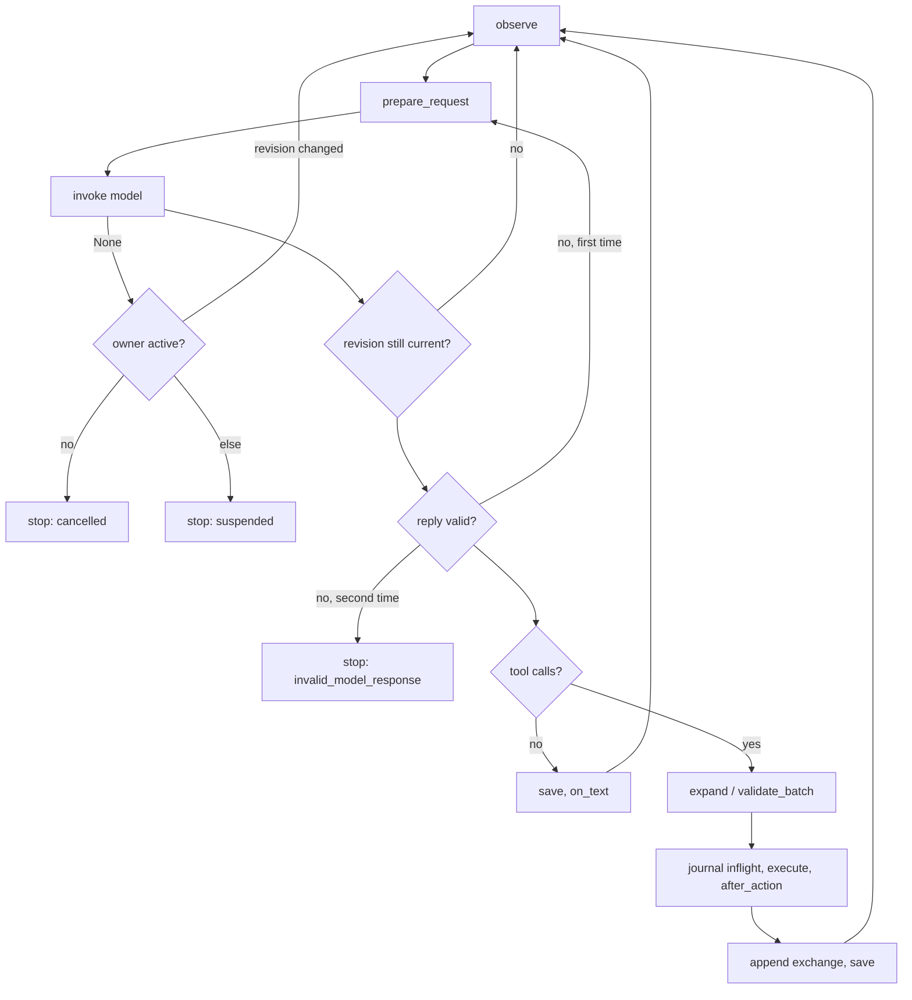

# Decision loop

[Internals](README.md) · [Context engineering](context-engineering.md) ·
[Tools and safety](tools-and-safety.md)

Every autonomous decision in Eregion goes through one class,
`AgentLoop` in [`core/engine.py`](../../backend/eregion/runtime/core/engine.py).
It knows nothing about jobs, forms or interviews. A **host** supplies the
observation, the tools, the model call and persistence; the loop runs them in a
fixed, recoverable order.

## The host contract

[`core/host_protocol.py`](../../backend/eregion/runtime/core/host_protocol.py)
defines the methods a host must provide:

| Method | Responsibility |
| --- | --- |
| `active()` | False once the owner cancelled, paused or finished; no late result is accepted after that. |
| `revision()` | The current user-steering revision. A decision made for an older revision is discarded. |
| `observe()` | Build the next `Turn`: system prompt, live snapshot, offered tools, revision, images. May raise `LoopStop`. |
| `invoke(messages, tools, turn)` | Exactly one accounted model request; returns `None` when interrupted. |
| `progress(text, call, turn)` | Publish text that accompanies the first action of a reply. |
| `on_text(text, turn)` | Handle a reply with no tool call: a stop result, a notice, or nothing. |
| `execute(call, turn)` | Run one validated action and return its observed outcome. |
| `action_error(exc)` | Turn an exception into a safe tool result for the model. |
| `after_action(call, outcome, turn)` | Record the outcome; returning a dict stops the slice with that result. |
| `persist(runtime)` | Durably save the loop journal. |

Optional methods are used when present: `text_guard` (fence a text reply against
concurrent steering), `validate_batch` (check a multi-call reply before any
effect), `validate` (replace the default schema check), `expand_call` (lower one
compound call into ordinary calls), `output_problem` (replace the default reply
check) and `image_message` (turn a screenshot into model input).

Four hosts use the kernel:

| Host | File | Used for | Loop settings |
| --- | --- | --- | --- |
| `TaskHost` | [`tasks/host.py`](../../backend/eregion/runtime/tasks/host.py) | Career chat tasks (search, scoring, materials, interviews, starting applications) | request size from the harness (48,000 chars for the career harness) |
| `ApplicationHost` | [`auto_apply/runner.py`](../../backend/eregion/runtime/auto_apply/runner.py) | Filling one application form in a browser worker | replay window 12,000 chars |
| `SessionHost` | [`sessions/coordinator.py`](../../backend/eregion/runtime/sessions/coordinator.py) | Persisted API sessions with governed context snapshots | `slice_steps = max_loop_iterations + 2` |
| tool-run host | [`tools/loop.py`](../../backend/eregion/runtime/tools/loop.py) | Bounded tool runs | `slice_steps = max_iterations + 1` |

Defaults in `AgentLoop.__init__`: `slice_steps=12`, replay window
`context_chars=24000`, whole request `request_chars=64000`.

## One turn, step by step

`AgentLoop.run()` executes at most `slice_steps` turns, then yields the worker
(yielding never asks the user anything). Each turn:

1. **Recover an interrupted action.** If the journal holds an `inflight` action
   from a previous slice, the loop does not replay it. It adds
   `runtime_feedback.interrupted_action` to the next observation: "this action
   may have completed; inspect actual state before deciding".
2. **Check the owner** (`active()`), then **observe**. The host returns a
   `Turn`. Any recovery notice is added as `runtime_feedback`.
3. **Fix the tool list.** `read_context` is always appended, except when the
   snapshot says `must_decide` or `completion_required` (the host has restricted
   the model to finishing). Host description overrides are applied last.
4. **Build the request** with `prepare_request` (system prompt, replayed
   history, live snapshot, size budget). See
   [Context engineering](context-engineering.md). The size metrics are stored
   in the journal as `context_metrics`.
5. **Call the model** inside `usage_scope(context_metrics=...)`, so the ledger
   row records request sizes. `None` means interrupted: if the owner is gone the
   loop stops as `cancelled`; if the user sent a new message the decision is
   discarded and the loop observes again; otherwise it stops as `suspended`.
6. **Discard stale decisions.** If the revision changed while the model was
   thinking, the reply is dropped (`decision_discarded`) and the turn restarts.
7. **Check the reply** (`output_problem` in
   [`model_output.py`](../../backend/eregion/runtime/model_output.py)). An
   incomplete or malformed reply gets one repair attempt with
   `REPAIR_INSTRUCTION` (plus `TRUNCATED_INSTRUCTION` when it was cut off); a
   second bad reply stops the slice as `invalid_model_response`.
8. **Text-only reply.** The text is added to the replay window and saved
   before `on_text` runs, so a completion is never published before it is
   durable. `on_text` may stop the slice (for example `needs_input`) or return a
   notice for the next turn. In the career host, plain text is progress;
   completing a request always requires the explicit `finish_task` control.
9. **Tool calls.**
   - A lone `finish_task({})` with accompanying text takes that text as its
     summary.
   - If the host implements `expand_call` (the application host does, for
     `apply_record`), one compound call may become 1 to 64 ordinary calls. Each
     child is schema-checked and must be batchable.
   - If every call is batchable, the whole batch goes through `validate_batch`
     **before any effect**. A rejected batch returns the same error to every call.
   - Each call is then run in order. Before the first, `progress` publishes the
     accompanying text. Before **each** call, the loop writes
     `inflight = {tool, call_id, revision, arguments}` to the journal and saves:
     intent is durable before the effect happens. `read_context` is served by the
     archive; everything else goes to `host.execute`.
   - Calls after a stop, after a failed expansion, after the first call of a
     non-batch reply, or after the user steered, are not run; they return
     `{"deferred": true, "next": "Read the fresh observation..."}`.
   - Every outcome passes `after_action` (which may stop the slice), then
     `archive.tool_result`, which keeps small results inline and moves large ones
     behind a `context_ref`.
   - An expanded compound call is answered once in the transcript, with a list of
     child results and a `partial` flag, because the provider expects one result
     per original call id.
10. **Record and save.** The complete exchange (snapshot request, assistant
    text, calls, results) is appended to the replay window and the journal is
    saved.

## Stops

A slice ends with a result dict whose `reason` tells the owner what to do next.
`LoopStop(reason, **details)` is how hosts end a slice on purpose. Reasons in use
include:

| Reason | Meaning |
| --- | --- |
| `yielded` | Slice step limit or worker deadline reached; work continues in a new slice. |
| `cancelled`, `steered` | The owner stopped, or a newer user message replaced this decision. |
| `suspended` | The model call was interrupted without a newer revision. |
| `needs_input` | A question for the user is pending. |
| `ready` | The application host reached review. |
| `agent_limit`, `page_budget`, `provider_budget` | A call budget was reached (see [Models and budgets](models-and-budgets.md)). |
| `no_progress` | The repeat guard saw the same failing action too often. |
| `authentication_required`, `verification_required` | The site needs the user (sign-in, CAPTCHA). |
| `invalid_model_response` | Two unusable replies in a row. |
| `failed` | An unexpected exception; the journal is still saved. |

`TaskProviderBudgetExceeded` is re-raised so that no fallback can swallow a
budget stop. The `finally` block always records `slice_finished` and saves.

## The journal

`AgentLoop.runtime` is the loop's durable state, saved by `host.persist` after
every effect:

- `transcript`: the replay window (complete tool exchanges, see
  [Context engineering](context-engineering.md#the-replay-window)).
- `context_archive`, `context_read_progress`, `context_resources`: archived
  values, what was already read, and resource versions.
- `inflight`: the action whose effect may be in progress.
- `recovery`: a notice for the next observation.
- `events`: the last 80 lifecycle events (`model_started`, `tool_started`,
  `decision_discarded`, `output_rejected`, `slice_finished`, ...), with sequence
  numbers and timestamps.
- `context_metrics`: sizes of the last request.

Hosts receive a JSON copy of this state, never the engine's own lists. Because
the journal is reloaded at the start of each slice, a restart continues the
same task with the same budget and the same transcript; it never grants a new
allowance and never replays an uncertain external effect.

## Schema validation

`validate_call` checks a call against the advertised JSON schema before any
host code runs: the tool must be advertised in this turn; types, enums,
required and unknown properties, `minItems`/`maxItems`, string lengths and
numeric ranges are enforced; `$ref` and `anyOf` are followed. Domain checks
(sources, field state, permissions) stay inside the tools.
